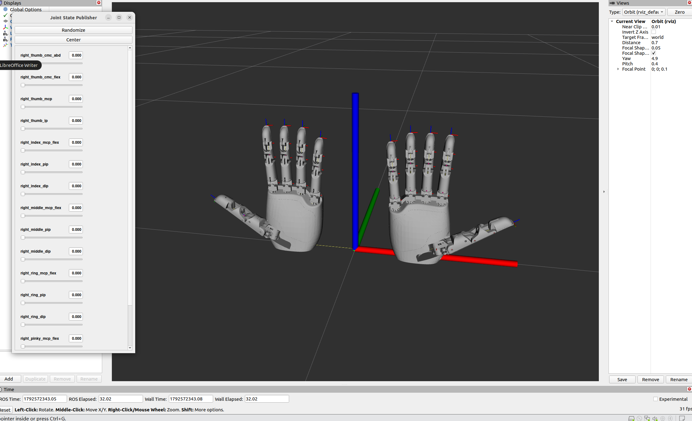
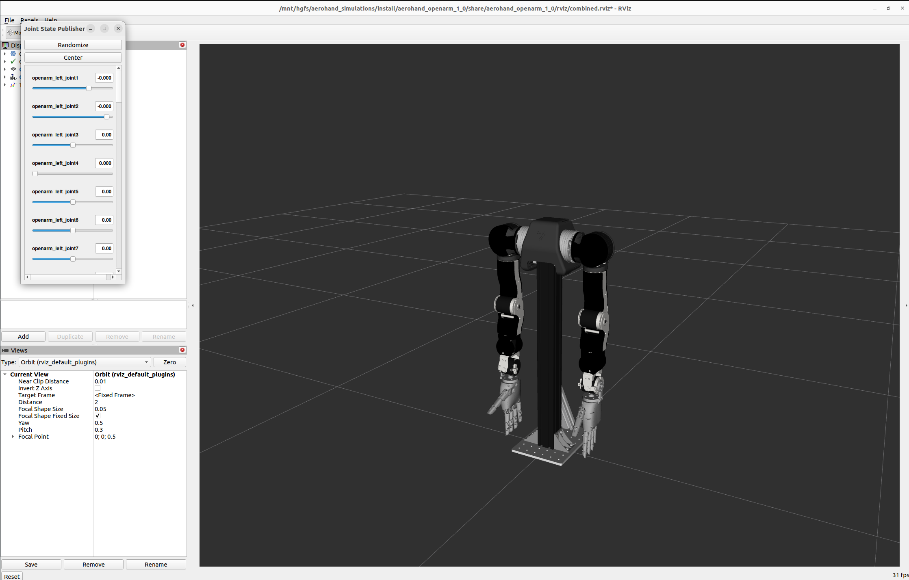
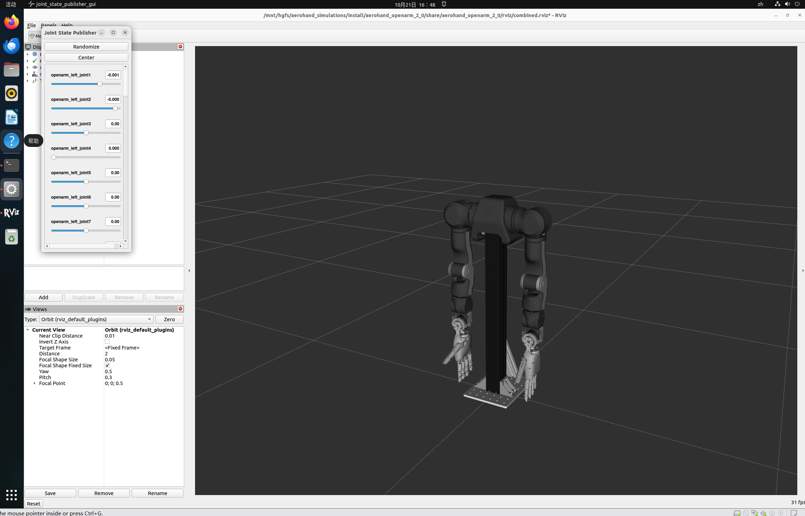
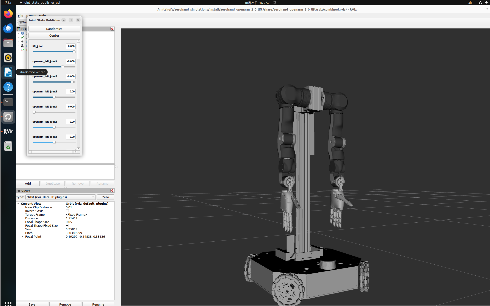
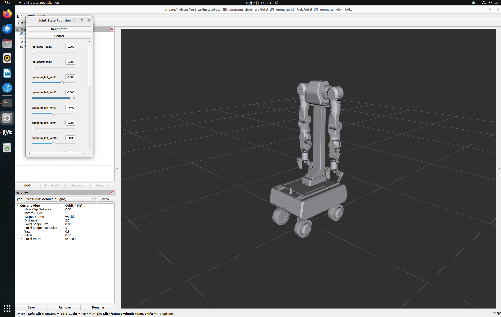

# OpenArm 与 AeroHand ROS 2 仿真合集

本仓库整理了 AeroHand 灵巧手、OpenArm 双臂以及升降装置的 ROS 2 描述模型与 RViz 关节可视化示例。模型通过 Joint State Publisher GUI 调节关节状态，由 `robot_state_publisher` 发布 TF，再在 RViz 中显示。

> 这些示例用于 URDF/Xacro 模型展示和关节运动学可视化，不是 Gazebo 物理仿真，也不会驱动真实机器人。

## 仿真效果

<table>
  <tr>
    <td align="center"><strong>AeroHand</strong><br></td>
    <td align="center"><strong>AeroHand + OpenArm 1.0</strong><br></td>
  </tr>
  <tr>
    <td align="center"><strong>AeroHand + OpenArm 2.0</strong><br></td>
    <td align="center"><strong>AeroHand + OpenArm 2.0 + 升降机构</strong><br></td>
  </tr>
  <tr>
    <td align="center"><strong>total_lift_openarm_sim</strong><br></td>
    <td></td>
  </tr>
</table>

## 项目内容

| 子项目 | 包含内容 | ROS 包名 |
|---|---|---|
| `aerohand_simulations` | AeroHand 单独模型、OpenArm v1.0/v2.0 双臂组合、OpenArm v2.0 与升降机构组合 | `aerohand`、`aerohand_openarm_1_0`、`aerohand_openarm_2_0`、`aerohand_openarm_2_0_lift` |
| `total_lift_openarm_sim` | 移动底盘、两级升降柱、OpenArm v1.1 与联动夹爪 | `total_lift_openarm_sim` |

两个目录是独立的 ROS 2 构建入口。前四种模型共用 `aerohand_simulations/src/openarm_description`；总装模型使用自己的 URDF、RViz 配置和夹爪闭环解算节点。

## 环境准备

以下步骤以 **Ubuntu 22.04、ROS 2 Humble、RViz 2** 为例。请在 Ubuntu/ROS 2 终端执行；Windows PowerShell 不能直接运行这些 ROS 命令。开始前，需要先按 [ROS 2 Humble 官方安装指南](https://docs.ros.org/en/humble/Installation/Ubuntu-Install-Debs.html) 安装 `ros-humble-desktop`（包含 RViz 2）并配置 ROS 软件源。下面只安装工作区构建工具，不会安装 ROS 发行版本身。

安装构建与依赖工具：

```bash
sudo apt update
sudo apt install -y python3-colcon-common-extensions python3-rosdep python3-catkin-pkg
```

若系统尚未初始化 `rosdep`，首次使用时运行一次 `sudo rosdep init`。如果当前终端启用了 Conda，先退出 Conda，再 source ROS：

```bash
if [ -n "${CONDA_PREFIX:-}" ] && command -v conda >/dev/null 2>&1; then
  conda deactivate
fi

source /opt/ros/humble/setup.bash
rosdep update
```

每次打开新的终端，都需要重新 `source /opt/ros/humble/setup.bash`，再 source 对应工作区的 `install/setup.bash`。

## AeroHand 与 OpenArm：构建并启动四种模型

### 1. 进入工作区并安装依赖

假设仓库克隆在 `~/openarm-lift-simulations`。如果你的仓库放在其他位置，请把下面路径替换成实际路径：

```bash
cd ~/openarm-lift-simulations/aerohand_simulations
if [ -n "${CONDA_PREFIX:-}" ] && command -v conda >/dev/null 2>&1; then
  conda deactivate
fi
source /opt/ros/humble/setup.bash
rosdep install --from-paths src --ignore-src -r -y
```

### 2. 构建工作区

```bash
colcon build \
  --symlink-install \
  --cmake-clean-cache \
  --cmake-args \
    -DPython3_EXECUTABLE=/usr/bin/python3 \
    -DPYTHON_EXECUTABLE=/usr/bin/python3

source install/setup.bash
```

构建命令指定 Ubuntu 系统 Python，避免 CMake 误用 Conda Python。如果 `colcon` 明确提示 `openarm_description` 与已 source 的 underlay 包重名，并且你确认要用本工作区里的版本，再给构建命令添加 `--allow-overriding openarm_description`。该选项会略过覆盖检查；不要在未确认覆盖关系时盲目添加。

### 3. 选择一个模型启动

在已经 source 过上面两个 setup 文件的终端中，任选一条命令：

| 模型 | 启动命令 |
|---|---|
| AeroHand 左右手 | `ros2 launch aerohand display.launch.py` |
| AeroHand + OpenArm 1.0 | `ros2 launch aerohand_openarm_1_0 display_v11.launch.py` |
| AeroHand + OpenArm 2.0 | `ros2 launch aerohand_openarm_2_0 display_v20.launch.py` |
| AeroHand + OpenArm 2.0 + 升降机构 | `ros2 launch aerohand_openarm_2_0_lift display_lift_v20.launch.py` |

每条 launch 命令会启动对应的 `robot_state_publisher`、Joint State Publisher GUI 和 RViz。切换到另一个模型前，在当前终端按 `Ctrl+C` 关闭当前 launch，再运行另一条命令。

### 4. 在 RViz 中调整姿态

1. 等待 RViz 和 **Joint State Publisher** 滑块窗口打开。
2. 拖动滑块调整手指、手腕和 OpenArm 各关节；带升降机构的版本也可以调整升降关节。
3. 点击滑块窗口的 **Center** 可回到零位；**Randomize** 可生成随机关节姿态。
4. 退出时在启动 launch 的终端按 `Ctrl+C`。

这里的滑块发布关节状态用于更新 RViz 模型姿态；它不包含电机控制、Gazebo 动力学或自动碰撞停止。

## total_lift_openarm_sim：构建并启动移动升降总装

此示例是单独的 ROS 包。下面假设仓库位于 `~/openarm-lift-simulations`，并把该包复制到 `~/ros2_ws`。若仓库位于其他路径，请调整 `cp` 命令中的仓库目录。

```bash
mkdir -p ~/ros2_ws/src
cp -a ~/openarm-lift-simulations/total_lift_openarm_sim ~/ros2_ws/src/
cd ~/ros2_ws
if [ -n "${CONDA_PREFIX:-}" ] && command -v conda >/dev/null 2>&1; then
  conda deactivate
fi
source /opt/ros/humble/setup.bash
rosdep install --from-paths src --ignore-src -r -y
colcon build \
  --packages-select total_lift_openarm_sim \
  --cmake-clean-cache \
  --cmake-args -DPython3_EXECUTABLE=/usr/bin/python3
source install/setup.bash
ros2 launch total_lift_openarm_sim display.launch.py
```

如果 `~/ros2_ws/src/total_lift_openarm_sim` 已经存在，并且要把它更新为仓库里的版本，在构建前用下面命令同步同名文件；它会覆盖工作区中的同名文件，请先保存你在工作区里单独做过的修改：

```bash
cp -a ~/openarm-lift-simulations/total_lift_openarm_sim/. ~/ros2_ws/src/total_lift_openarm_sim/
```

启动后会打开 RViz、Joint State Publisher GUI 和夹爪闭环解算节点：

- `lift_stage1_joint` 控制中段升降，URDF 行程为 `0–0.319 m`。
- `lift_stage2_joint` 控制上段升降，URDF 行程为 `0–0.288 m`。
- 左右 OpenArm 各有 7 个旋转关节，可用滑块调整。
- `openarm_left_gripper_close_joint` 和 `openarm_right_gripper_close_joint` 分别控制左右夹爪开合；夹爪转子、连杆和镜像滑块由模型 mimic 关系及解算节点联动。

此总装的滑块用于查看模型运动关系。RViz 不执行碰撞判定，也不会控制实体升降柱或机械臂。

## 目录与进一步说明

- [AeroHand 仿真工作区说明](aerohand_simulations/README.md)
- [总装升降柱与 OpenArm 说明](total_lift_openarm_sim/README.md)
- [AeroHand 第三方与许可证说明](aerohand_simulations/THIRD_PARTY_NOTICES.md)
- [总装模型第三方与许可证说明](total_lift_openarm_sim/LICENSES/THIRD_PARTY_NOTICES.md)

## 许可证与模型来源

不同部分采用不同许可，请以各目录内的许可证和第三方声明为准。AeroHand 硬件设计资源采用 CC BY-NC-SA 4.0；OpenArm 官方描述资源采用 Apache-2.0。连接件、升降结构及总装中的部分网格由 STEP 装配导出，公开再分发前需要确认原始 STEP 资产的授权范围。
